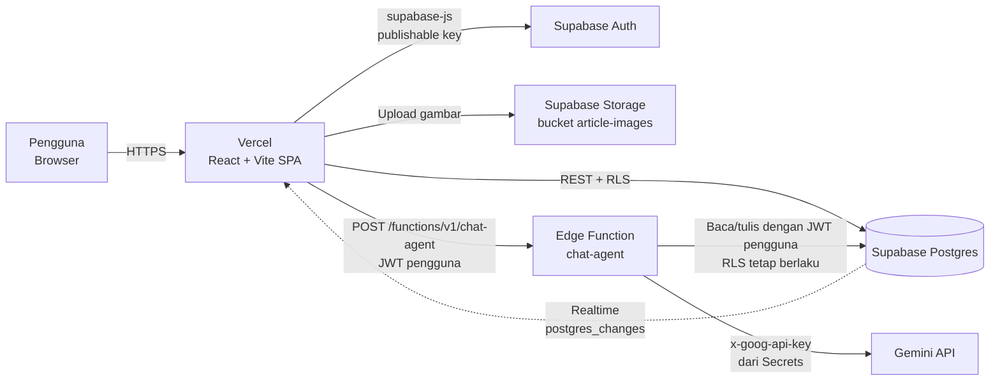
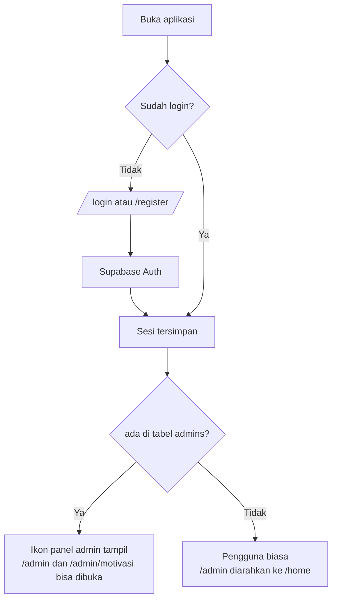
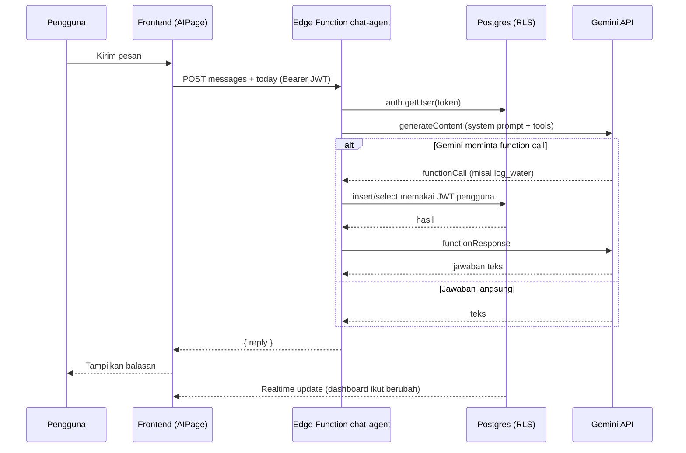
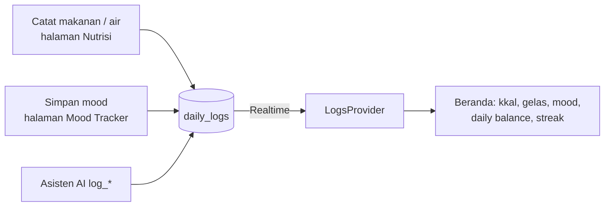

# Valitudo AI

> **Life good. Be healthy.**
> Ruang harian untuk hidup lebih sehat: artikel kesehatan, pencatat nutrisi dan hidrasi, dukungan kesehatan mental, dan asisten AI dalam satu aplikasi web.

**Demo:** https://valitudo-ai.vercel.app

---

## Daftar Isi

1. [Pengenalan Projek](#1-pengenalan-projek)
2. [Technical Documentation](#2-technical-documentation)
3. [Frontend Documentation](#3-frontend-documentation)
4. [Backend Documentation](#4-backend-documentation)
5. [Petunjuk Localhost](#5-petunjuk-localhost)
6. [Deploy](#6-deploy)
7. [Catatan Keamanan](#7-catatan-keamanan)

---

## 1. Pengenalan Projek

### Gambaran Solusi

Valitudo adalah aplikasi web kesehatan harian. Pengguna dapat:

| Fitur | Penjelasan |
|---|---|
| **Artikel kesehatan** | Artikel kategori Gizi, Tidur, Olahraga, dan Mental. Admin menambah, mengedit, dan menghapus artikel (termasuk upload gambar) lewat panel admin. |
| **Dashboard "Hari ini"** | Ringkasan kalori, gelas air, mood, *daily balance*, dan *streak* yang dihitung dari data yang diisi pengguna. Nilai awal 0 dan ikut berubah secara real time. |
| **Pencatat konsumsi** | Mencatat makanan (kkal) dan air minum harian. |
| **Rencana makan mingguan** | Menyusun menu per hari (Senin sampai Minggu) yang bisa diubah dan dihapus. |
| **Kesehatan mental** | Journaling pribadi, Mood Tracker, Motivation Word (dikelola admin), dan Drawing. |
| **Valitudo Assistant** | Asisten AI berbasis Gemini yang menjawab pertanyaan kesehatan umum, membaca catatan pengguna, dan mencatat air, makanan, atau mood atas permintaan pengguna. |

### Latar Belakang

Informasi kesehatan sering tersebar di banyak aplikasi dan situs: satu untuk artikel, satu untuk menghitung kalori, satu lagi untuk jurnal. Akibatnya kebiasaan sehat sulit dipertahankan secara konsisten. Valitudo menyatukan semuanya dalam satu ruang yang sederhana, sehingga pengguna bisa membaca, mencatat, dan bertanya di tempat yang sama.

### Target Pengguna

- Orang dewasa muda dan pekerja yang ingin memulai kebiasaan sehat tanpa aplikasi yang rumit.
- Pengguna yang ingin memantau nutrisi, hidrasi, dan suasana hati harian dalam satu tampilan.
- Pengelola konten (admin) yang menerbitkan artikel dan kata motivasi.

> **Disclaimer:** Valitudo memberikan informasi kesehatan umum dan bukan pengganti saran dokter. Asisten AI tidak memberi diagnosis, dosis obat, atau diet ekstrem.

### Tim

| Nama | Peran |
|---|---|
| _isi nama_ | _isi peran_ |
| _isi nama_ | _isi peran_ |

---

## 2. Technical Documentation

### Tech Stack

| Lapisan | Teknologi |
|---|---|
| Frontend | React 18, Vite, React Router, lucide-react |
| Backend as a Service | Supabase (Auth, Postgres, Storage, Realtime, Edge Functions) |
| AI | Google Gemini API (dipanggil dari Supabase Edge Function) |
| Hosting | Vercel (frontend), Supabase (backend) |

### Arsitektur Sistem



Prinsip desainnya:

- **Browser tidak pernah memegang kunci rahasia.** Key Gemini disimpan di Supabase Secrets dan hanya dibaca oleh Edge Function.
- **Keamanan data ada di database.** Row Level Security (RLS) membatasi setiap pengguna hanya pada datanya sendiri, termasuk saat Edge Function bertindak atas nama pengguna.
- **Frontend hanya memakai publishable key**, yang aman untuk publik selama RLS aktif.

### Alur Autentikasi dan Peran



### Alur Asisten AI



### Alur Data "Hari ini"



Aturan perhitungan (di `src/lib/logs.jsx`):

- **Nutrition** = kkal hari ini dibanding target 2000 kkal.
- **Hydration** = gelas hari ini dibanding target 8 gelas.
- **Mood** = skor dari mood terakhir hari itu (Senang 100, Bersyukur 90, Sedih 40, Kecewa 30, Marah 20).
- **Daily balance** = rata-rata ketiganya. 70 ke atas "Good", 40 sampai 69 "Cukup", di bawah 40 "Perlu perhatian", dan "Belum ada" jika belum ada data.
- **Streak** = jumlah hari berurutan yang ada pengisian. Streak kembali ke 0 jika lebih dari 24 jam sejak pengisian terakhir.

---

## 3. Frontend Documentation

### Framework dan Library

| Library | Fungsi |
|---|---|
| React 18 + Vite | UI dan build tool |
| react-router-dom | Routing (SPA) |
| @supabase/supabase-js | Auth, database, storage, realtime, pemanggilan Edge Function |
| lucide-react | Ikon |

### Struktur Folder

```
Valitudo-AI/
├── public/                     # Aset statis
├── design-reference/           # Referensi desain UI
├── src/
│   ├── assets/                 # logo.png, home-banner.png, runner-cutout.png
│   ├── lib/
│   │   ├── supabase.js         # Klien Supabase
│   │   ├── auth.jsx            # AuthProvider, useAuth (sesi + status admin)
│   │   ├── articles.js         # CRUD artikel, upload gambar, hook useArticles
│   │   ├── logs.jsx            # LogsProvider (kkal, air, mood, streak, realtime)
│   │   ├── mealPlan.js         # CRUD rencana makan mingguan
│   │   ├── motivations.js      # CRUD kata motivasi
│   │   └── journal.js          # CRUD catatan jurnal
│   ├── main.jsx                # Semua halaman dan komponen UI
│   └── styles.css              # Seluruh gaya
├── supabase/
│   └── functions/chat-agent/   # Edge Function asisten AI (Deno/TypeScript)
├── index.html
├── vercel.json                 # Rewrite SPA
├── .env.example
└── package.json
```

### Routing

| Path | Halaman | Akses |
|---|---|---|
| `/login`, `/register` | Masuk dan daftar | Publik (jika belum login) |
| `/home` | Beranda: banner, panel "Hari ini", artikel pilihan | Login |
| `/news`, `/article/:slug` | Daftar dan detail artikel | Login |
| `/mental` | Pintu masuk fitur kesehatan mental | Login |
| `/journal`, `/mood`, `/motivation`, `/drawing` | Journaling, Mood Tracker, Motivation Word, Drawing | Login |
| `/nutrition` | Catat konsumsi + rencana makan mingguan | Login |
| `/ai` | Valitudo Assistant | Login |
| `/profile` | Profil | Login |
| `/admin`, `/admin/motivasi` | Kelola artikel dan motivasi | **Admin** |

### Komponen Utama (`src/main.jsx`)

| Komponen | Fungsi |
|---|---|
| `App`, `Shell`, `Sidebar` | Rangka aplikasi, rute, navigasi (ikon admin hanya tampil untuk admin) |
| `Protected`, `PublicOnly` | Penjaga rute berdasarkan sesi |
| `Auth` | Form masuk dan daftar |
| `HomePage`, `Stat` | Dashboard "Hari ini" dan artikel pilihan |
| `NewsPage`, `ArticleCard`, `ArticleDetailPage` | Daftar, pencarian, dan detail artikel |
| `NutritionPage`, `TodayLog` | Rencana makan mingguan dan pencatat konsumsi harian |
| `MentalPage`, `JournalPage`, `MoodPage`, `MotivationPage`, `DrawingPage` | Fitur kesehatan mental |
| `AIPage` | Antarmuka obrolan dengan asisten |
| `AdminArticlesPage`, `AdminMotivationPage`, `AdminTabs` | Panel admin |
| `Page`, `Reveal`, `Chips`, `Field`, `Footer` | Komponen UI bersama |

### Aset

Logo dan banner berada di `src/assets/`. Gambar artikel diunggah admin ke bucket Supabase Storage `article-images`.

---

## 4. Backend Documentation

Backend memakai Supabase, tanpa server buatan sendiri.

### 4.1 Database Schema

| Tabel | Isi | Akses |
|---|---|---|
| `admins` | Daftar user yang menjadi admin | Pengguna hanya bisa membaca barisnya sendiri |
| `articles` | Artikel kesehatan | Publik baca, admin tulis |
| `motivations` | Kata motivasi | Publik baca, admin tulis |
| `daily_logs` | Catatan makanan, air, dan mood harian | Hanya pemilik |
| `meal_plans` | Rencana makan mingguan | Hanya pemilik |
| `journal_entries` | Catatan jurnal | Hanya pemilik |

Storage: bucket publik `article-images` (upload dan hapus hanya admin).

<details>
<summary><b>SQL lengkap (jalankan di Supabase SQL Editor)</b></summary>

```sql
-- ========== Fungsi bersama ==========
create or replace function set_updated_at() returns trigger language plpgsql as $$
begin
  new.updated_at = now();
  return new;
end;
$$;

-- ========== admins ==========
create table admins (
  user_id uuid primary key references auth.users(id) on delete cascade
);
alter table admins enable row level security;
create policy "read own admin row" on admins
  for select to authenticated using (user_id = auth.uid());

-- ========== articles ==========
create table articles (
  id uuid primary key default gen_random_uuid(),
  slug text unique not null,
  title text not null,
  category text not null,
  excerpt text,
  body text,
  image_url text,
  published_at date not null default current_date,
  created_at timestamptz default now()
);
alter table articles enable row level security;
create policy "public read articles" on articles for select using (true);
create policy "admin manage articles" on articles
  for all to authenticated
  using (exists (select 1 from admins where admins.user_id = auth.uid()))
  with check (exists (select 1 from admins where admins.user_id = auth.uid()));

-- ========== motivations ==========
create table motivations (
  id uuid primary key default gen_random_uuid(),
  emoji text not null check (char_length(emoji) between 1 and 16),
  message text not null check (char_length(message) between 1 and 200),
  color text not null check (color in ('green','orange','cyan','pink','lavender','yellow')),
  sort_order integer not null default 0,
  created_at timestamptz not null default now()
);
alter table motivations enable row level security;
create policy "public read motivations" on motivations for select using (true);
create policy "admin manage motivations" on motivations
  for all to authenticated
  using (exists (select 1 from admins where admins.user_id = auth.uid()))
  with check (exists (select 1 from admins where admins.user_id = auth.uid()));

-- ========== daily_logs ==========
create table daily_logs (
  id uuid primary key default gen_random_uuid(),
  user_id uuid not null default auth.uid() references auth.users(id) on delete cascade,
  kind text not null check (kind in ('meal','water','mood')),
  log_date date not null,
  label text,
  kcal integer not null default 0,
  created_at timestamptz not null default now()
);
create index daily_logs_user_date on daily_logs (user_id, log_date);
alter table daily_logs enable row level security;
create policy "own logs select" on daily_logs for select to authenticated using (user_id = auth.uid());
create policy "own logs insert" on daily_logs for insert to authenticated with check (user_id = auth.uid());
create policy "own logs delete" on daily_logs for delete to authenticated using (user_id = auth.uid());
alter publication supabase_realtime add table daily_logs;
alter table daily_logs replica identity full;

-- ========== meal_plans ==========
create table meal_plans (
  id uuid primary key default gen_random_uuid(),
  user_id uuid not null default auth.uid() references auth.users(id) on delete cascade,
  day_name text not null check (day_name in ('Senin','Selasa','Rabu','Kamis','Jumat','Sabtu','Minggu')),
  meal_time text not null check (meal_time in ('Sarapan','Makan siang','Makan malam','Camilan')),
  name text not null check (char_length(name) between 1 and 120),
  note text check (char_length(note) <= 300),
  created_at timestamptz not null default now(),
  updated_at timestamptz not null default now()
);
create index meal_plans_user_day on meal_plans (user_id, day_name);
create trigger meal_plans_updated_at before update on meal_plans
  for each row execute function set_updated_at();
alter table meal_plans enable row level security;
create policy "own meal plans select" on meal_plans for select to authenticated using (user_id = auth.uid());
create policy "own meal plans insert" on meal_plans for insert to authenticated with check (user_id = auth.uid());
create policy "own meal plans update" on meal_plans for update to authenticated
  using (user_id = auth.uid()) with check (user_id = auth.uid());
create policy "own meal plans delete" on meal_plans for delete to authenticated using (user_id = auth.uid());

-- ========== journal_entries ==========
create table journal_entries (
  id uuid primary key default gen_random_uuid(),
  user_id uuid not null default auth.uid() references auth.users(id) on delete cascade,
  title text not null check (char_length(title) between 1 and 120),
  body text not null default '' check (char_length(body) <= 10000),
  entry_date date not null default current_date,
  created_at timestamptz not null default now(),
  updated_at timestamptz not null default now()
);
create index journal_entries_user_created on journal_entries (user_id, created_at desc);
create trigger journal_entries_updated_at before update on journal_entries
  for each row execute function set_updated_at();
alter table journal_entries enable row level security;
create policy "own journal select" on journal_entries for select to authenticated using (user_id = auth.uid());
create policy "own journal insert" on journal_entries for insert to authenticated with check (user_id = auth.uid());
create policy "own journal update" on journal_entries for update to authenticated
  using (user_id = auth.uid()) with check (user_id = auth.uid());
create policy "own journal delete" on journal_entries for delete to authenticated using (user_id = auth.uid());

-- ========== Storage ==========
insert into storage.buckets (id, name, public)
values ('article-images', 'article-images', true)
on conflict (id) do nothing;

create policy "admin upload article images" on storage.objects
  for insert to authenticated
  with check (bucket_id = 'article-images'
    and exists (select 1 from admins where admins.user_id = auth.uid()));
create policy "admin delete article images" on storage.objects
  for delete to authenticated
  using (bucket_id = 'article-images'
    and exists (select 1 from admins where admins.user_id = auth.uid()));
```

</details>

**Menjadikan akun sebagai admin** (ganti email):

```sql
insert into admins (user_id)
select id from auth.users where email = 'email-admin@contoh.com'
on conflict do nothing;
```

### 4.2 API Endpoints

Semua endpoint memakai base URL `https://<PROJECT_REF>.supabase.co`. Header yang dikirim `supabase-js` secara otomatis: `apikey: <publishable key>` dan `Authorization: Bearer <JWT pengguna>`.

#### Auth (`/auth/v1`)

| Metode | Endpoint | Fungsi |
|---|---|---|
| POST | `/auth/v1/signup` | Daftar akun |
| POST | `/auth/v1/token?grant_type=password` | Login |
| POST | `/auth/v1/logout` | Logout |
| PUT | `/auth/v1/user` | Ubah profil (nama) |

#### Data (`/rest/v1`, dibatasi RLS)

| Tabel | GET | POST | PATCH | DELETE |
|---|---|---|---|---|
| `articles` | Semua | Admin | Admin | Admin |
| `motivations` | Semua | Admin | Admin | Admin |
| `admins` | Baris sendiri | n/a | n/a | n/a |
| `daily_logs` | Milik sendiri | Milik sendiri | n/a | Milik sendiri |
| `meal_plans` | Milik sendiri | Milik sendiri | Milik sendiri | Milik sendiri |
| `journal_entries` | Milik sendiri | Milik sendiri | Milik sendiri | Milik sendiri |

Contoh: `GET /rest/v1/articles?select=*&order=published_at.desc`

#### Storage (`/storage/v1`)

| Metode | Endpoint | Fungsi |
|---|---|---|
| POST | `/storage/v1/object/article-images/<file>` | Upload gambar (admin) |
| GET | `/storage/v1/object/public/article-images/<file>` | Ambil gambar (publik) |

#### Edge Function: `chat-agent`

`POST /functions/v1/chat-agent`

Header: `Authorization: Bearer <JWT pengguna>`

Request:

```json
{
  "messages": [
    { "role": "user", "content": "Hari ini aku sudah minum berapa gelas?" }
  ],
  "today": "2026-11-14"
}
```

Response sukses:

```json
{ "reply": "Hari ini kamu sudah minum 3 gelas dari target 8." }
```

Response gagal (`401` sesi tidak valid, `400` pesan kosong, `502` Gemini tidak tersedia):

```json
{ "error": "Asisten sedang tidak tersedia. Coba lagi sebentar." }
```

Alat yang dapat dipanggil asisten (semuanya berjalan dengan JWT pengguna, sehingga RLS tetap berlaku):

| Tool | Fungsi |
|---|---|
| `get_today_summary` | Total kkal, daftar makanan, gelas air, mood hari ini |
| `get_meal_plan` | Rencana makan mingguan (opsional per hari) |
| `log_water` | Mencatat 1 sampai 10 gelas air |
| `log_meal` | Mencatat makanan, kkal, dan waktu makan |
| `log_mood` | Mencatat mood (Senang, Sedih, Kecewa, Bersyukur, Marah) |

Batasan di system prompt: tidak mendiagnosis, tidak memberi dosis obat, tidak memberi diet ekstrem, dan mengarahkan ke 112/119 untuk gejala berat.

### 4.3 Environment Variables

**Frontend** (file `.env.local`, lihat `.env.example`):

| Variabel | Keterangan |
|---|---|
| `VITE_SUPABASE_URL` | Project URL, tanpa `/rest/v1/` dan tanpa `/` di akhir |
| `VITE_SUPABASE_ANON_KEY` | Publishable key (`sb_publishable_...`) |

**Edge Function** (Supabase Secrets, bukan di repo):

| Secret | Keterangan |
|---|---|
| `GEMINI_API_KEY` | Key dari Google AI Studio |
| `GEMINI_MODEL` | Opsional, default `gemini-3.5-flash` |

`SUPABASE_URL` dan `SUPABASE_ANON_KEY` disediakan otomatis oleh Supabase untuk Edge Function.

---

## 5. Petunjuk Localhost

### Prasyarat

- **Node.js 20** atau lebih baru (cek dengan `node -v`) dan npm
- **Git**
- Akun **Supabase** (gratis)
- _Opsional, untuk asisten AI:_ API key Gemini dari https://aistudio.google.com/apikey dan Supabase CLI (dipanggil lewat `npx`)

### Langkah 1: Ambil kode dan install dependensi

```bash
git clone https://github.com/aracles03/Valitudo-AI.git
cd Valitudo-AI
npm install
```

### Langkah 2: Siapkan Supabase

Pilih salah satu.

**Opsi A: memakai project Supabase milik tim.**
Minta `VITE_SUPABASE_URL` dan `VITE_SUPABASE_ANON_KEY` dari tim, lalu lanjut ke Langkah 3. Tabel dan Edge Function sudah ada, sehingga asisten AI langsung berfungsi.

**Opsi B: membuat project Supabase sendiri.**

1. Buat project di https://supabase.com, region disarankan Southeast Asia (Singapore).
2. Buka **SQL Editor**, lalu jalankan seluruh SQL di [bagian 4.1](#41-database-schema).
3. Buka **Authentication → Sign In / Providers**, pastikan Email aktif. Untuk percobaan lokal, matikan **Confirm email**.
4. Ambil **Project URL** (tombol **Connect**) dan **Publishable key** (**Settings → API Keys**).
5. _(Asisten AI)_ Deploy Edge Function:
   ```bash
   npx supabase login
   npx supabase link --project-ref <PROJECT_REF>
   npx supabase secrets set GEMINI_API_KEY=<KEY_GEMINI_ANDA>
   npx supabase functions deploy chat-agent --use-api
   ```
   Saat CLI meminta konfirmasi, pilih **Yes**. Tanpa langkah ini aplikasi tetap berjalan, tetapi halaman asisten akan menampilkan pesan tidak tersedia.

### Langkah 3: Atur environment variable

Salin contoh lalu isi nilainya:

```bash
# macOS / Linux
cp .env.example .env.local

# Windows (PowerShell)
Copy-Item .env.example .env.local
```

Isi `.env.local`:

```
VITE_SUPABASE_URL=https://xxxxxxxxxxxxxxxxxxxx.supabase.co
VITE_SUPABASE_ANON_KEY=sb_publishable_xxxxxxxxxxxxxxxx
```

### Langkah 4: Jalankan

```bash
npm run dev
```

Buka alamat yang tampil di terminal (biasanya http://localhost:5173).

Setiap kali `.env.local` diubah, hentikan server (Ctrl+C) lalu jalankan `npm run dev` lagi.

### Langkah 5: Coba aplikasinya

1. Buka `/register`, buat akun, lalu masuk. Beranda menampilkan angka 0 sampai ada data yang diisi.
2. Buka **Nutrisi**, catat makanan dan air, lalu lihat panel "Hari ini" berubah di beranda.
3. **Menjadi admin:** jalankan SQL `insert into admins ...` di [bagian 4.1](#41-database-schema) dengan email akun Anda, lalu login ulang. Ikon pensil muncul di sidebar untuk membuka `/admin`.
4. Tambahkan satu artikel lewat `/admin` agar beranda tidak kosong.
5. Buka **Assistant** dan kirim "hai" untuk menguji AI.

### Build produksi

```bash
npm run build      # hasil di folder dist/
npm run preview    # pratinjau build lokal
```

### Masalah Umum

| Gejala | Penyebab dan solusi |
|---|---|
| Layar putih atau "Failed to fetch" | `.env.local` belum terbaca. Cek nama file (bukan `.env.local.txt`), letaknya sejajar `package.json`, lalu restart `npm run dev`. |
| `new row violates row-level security policy` | Akun belum masuk tabel `admins` (untuk fitur admin), atau SQL belum dijalankan lengkap. |
| Ikon pensil admin tidak muncul | Akun belum ada di `admins`. Login ulang setelah menambahkan. |
| Asisten: "tidak tersedia" | Cek **Supabase → Edge Functions → chat-agent → Logs**. `400 API key not valid` berarti `GEMINI_API_KEY` salah. Set ulang lalu deploy ulang. |
| Gambar artikel tidak tampil | Bucket `article-images` harus berstatus Public. |

---

## 6. Deploy

1. Push kode ke GitHub.
2. Import repo di https://vercel.com (framework Vite terdeteksi otomatis, build `npm run build`, output `dist`).
3. Isi **Environment Variables**: `VITE_SUPABASE_URL` dan `VITE_SUPABASE_ANON_KEY`. Jangan isi key Gemini atau secret key Supabase di Vercel.
4. Di Supabase, buka **Authentication → URL Configuration**: isi **Site URL** dengan alamat Vercel dan tambahkan `https://<domain>/**` di **Redirect URLs**.

`vercel.json` memastikan refresh di halaman seperti `/ai` tidak menghasilkan 404.

---

## 7. Catatan Keamanan

- **Jangan commit** `.env.local`, key Gemini, atau `sb_secret_...` / service role key. Repo ini publik.
- Publishable key aman di frontend karena semua tabel dilindungi RLS.
- Key Gemini hanya tersimpan di Supabase Secrets.
- Jurnal, catatan konsumsi, dan rencana makan hanya dapat dibaca pemiliknya lewat aplikasi. Data tidak dienkripsi dari ujung ke ujung, sehingga pemilik project Supabase dapat melihatnya lewat dashboard.
- Untuk penggunaan publik: nyalakan **Confirm email**, pasang SMTP sendiri, dan pantau kuota Gemini karena setiap akun terdaftar dapat memakai asisten.
- Jika key pernah terlihat atau ter-commit, hapus dan buat yang baru, lalu set ulang di Supabase Secrets.

---

## Lisensi

_Isi sesuai kebutuhan tim._
